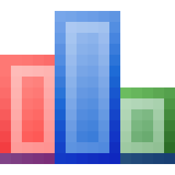

# Generic Company Data Dash

The Generic Company Inc. dashboard as a desktop program: a native window (Edge WebView2) running a Rust →
WebAssembly page. Charts are hand-built SVG. Generic Company Inc. and everyone in it is fictional.

Two tabs:

- **Business:** revenue (hero figure, by month, by category, top products), buyers, top customers, and
  tickets by status.
  - **Shared database:** the window opens the Generic Company database **read-only, by path** (`--db PATH`,
    `GENERIC_COMPANY_DB`, the file chosen with **Database…**, or `%LOCALAPPDATA%\Generic Company Inc\generic_company.db`) and reads every
    row of `orders`, `products`, `customers` and `tickets`, paged with `?limit=500&offset=N`, through the
    window's own `generic-company://` protocol (no network port). Writes are refused (405).
  - **Mock snapshot:** with no database (or `--mock`, or *Data → Mock snapshot*) the bundled `mock/`
    snapshot (3,000 orders, 400 tickets).
- **Numbers & tracks:** the two fixture files in `data/`, charted as `data/README.md` describes, with a
  filterable, paged table view.

## How it works

One crate, built two ways (`src/lib.rs`): `wasm-pack` compiles `core` and `web` into the page's
WebAssembly in `www/pkg/`; `cargo build --features desktop` compiles `core` and `host` into the exe.

1. `src/main.rs` fills a `Spec` (names, window size, the tables and columns the page may read, icon,
   smoke check) and calls `host::main` in `src/host/mod.rs`.
2. `host::main` parses the flags. `--version`, `--install` and `--uninstall` run `src/host/install.rs`
   and exit.
3. Otherwise `paths::resolve_db` (`src/host/paths.rs`) picks the database path and `choose` checks it
   with `api::check_schema`: every listed table and column must be there, or the program runs on the
   mock snapshot.
4. The window loads `generic-company://localhost/index.html`. `serve` answers each request: `/api/...`
   from SQLite (`src/host/api.rs`, a fresh read-only connection per request), `/host/db` for the
   database path, and anything else as a file from `www/` (`src/host/assets.rs`).
5. `www/index.html` loads `www/main.js`, which starts the wasm; `web::start` (`src/web.rs`) draws the
   Numbers & tracks tab from `data/*.dat` (compiled in) and wires the page.
6. `web::load_db` asks `GET /api/source` for the database, reads the four tables page by page
   (`fetch_all`) and draws the Business tab; with no database, in a plain browser, or on any error,
   `use_mock` draws it from `mock/*.json` (also compiled in).
7. `src/core` turns rows into HTML strings: `metrics`, `numbers` and `tracks` parse and aggregate,
   `svg` draws the charts, `render` lays out the views, `html::escape` guards every value. `web.rs`
   sets them as `innerHTML`; progress and errors go to the footer status.

Where state lives:

| What | Where |
|---|---|
| Shared database (read-only here) | `%LOCALAPPDATA%\Generic Company Inc\generic_company.db`, or the path from `--db`, `GENERIC_COMPANY_DB` or the settings |
| Settings (`db`, `version`) | `%LOCALAPPDATA%\Generic Company Inc\GenericCompany.Dash\settings.json` (`paths::save_settings`) |
| WebView2 profile | `%LOCALAPPDATA%\Generic Company Inc\GenericCompany.Dash\WebView2\` |
| Installed copy | `%LOCALAPPDATA%\Programs\Generic Company Inc\Generic Company Data Dash\`, with an `install.json` marker |
| Start menu and Apps & features | a shortcut, and `HKCU\...\Uninstall\GenericCompany.Dash` (`--root DIR` writes `DIR\registry.json` instead) |
| Page state (tab, filter, table page) | memory only, in `web.rs`'s `App`; nothing is saved |

## Code map

| File | What it does |
|---|---|
| `src/main.rs` | Entry point of `generic-company-dash.exe`: the `Spec` handed to `host::main` |
| `src/lib.rs` | The crate: which modules each build compiles |
| `src/host/mod.rs` | Flags, database choice, the window, the `generic-company://` protocol (`serve`) and `--smoke` |
| `src/host/paths.rs` | Database path order, settings file, per-app folders |
| `src/host/api.rs` | The CRUD hub's `/api` contract answered from SQLite; `check_schema` |
| `src/host/textsafe.rs` | The hub's text-cleaning rules (`api.rs` needs them; this program never writes) |
| `src/host/assets.rs` | Finds `www/`, maps URL paths to files, names Content-Types |
| `src/host/install.rs` | Per-user install and uninstall: files, shortcuts, uninstall entry |
| `build.rs` | Links `icon/app.res` (icon and DPI manifest) into the exe |
| `www/index.html` | The page shell; every element id `web.rs` uses |
| `www/main.js` | Loads the wasm build from `www/pkg/` |
| `www/style.css` | Layout, chart palette (light and dark), mark styles |
| `src/web.rs` | Page wiring: start-up, loading data, events, status line |
| `src/core/mod.rs` | The pure core and its data flow |
| `src/core/metrics.rs` | Order, product, customer and ticket rows; business metrics in whole cents |
| `src/core/numbers.rs` | `data/numbers.dat` parser and statistics |
| `src/core/tracks.rs` | `data/tracks.dat` parser and per-track grouping |
| `src/core/svg.rs` | Chart primitives: `hbars`, `columns`, `donut`, `line`, `paths` |
| `src/core/render.rs` | The two views and the number table as HTML |
| `src/core/html.rs` | `escape`, the one gate for data text into markup |
| `data/`, `mock/`, `icon/` | Fixture files, the hub snapshot and its schema, the pixel icon (each has a README) |

Tests sit in a `tests` module at the end of each file:

| Test group | Covers | Needs |
|---|---|---|
| `src/core/*.rs` (19 tests) | Parsing, cents arithmetic, formatting, chart geometry, views, escaping; the fixture counts in `data/README.md` | `cargo test` |
| `src/host/*.rs` (24 tests) | API over an in-memory database built from `mock/schema.sql`, file serving, installer in a sandbox root, settings, flags, text cleaning | `--features desktop` |
| `tests/icon.rs` (3 tests) | The icon files agree with each other and keep their credit | `cargo test` |

## Build and run

Needs Rust (MSVC toolchain) with the `wasm32-unknown-unknown` target and `wasm-pack`. In PowerShell, from
this folder:

```powershell
$env:CARGO_ENCODED_RUSTFLAGS = "--remap-path-prefix=$env:USERPROFILE=~"
```

```powershell
wasm-pack build --target web --out-dir www/pkg --no-typescript
```

```powershell
cargo build --release --features desktop
```

```powershell
target\release\generic-company-dash.exe
```

The first command keeps the build machine's paths out of the wasm and the exe: both builds write the
user folder, which holds cargo's crate sources and rustup's library sources, as `~` (one flag, so a
folder name with spaces works). The exe serves the page from the `www` folder beside it (or this project's `www`). `build.rs` links
`icon/app.res`: the pixel icon and a DPI-aware manifest. The page still runs in a plain browser on the
mock snapshot (`python -m http.server 8711 --directory www`; `?tab=fixtures` opens the second tab).

## Install

```powershell
target\release\generic-company-dash.exe --install
```

Installs for the current user: copies the exe and `www` to `%LOCALAPPDATA%\Programs\Generic Company Inc\Generic Company Data Dash\`,
adds **Generic Company Inc → Generic Company Data Dash** to the Start menu (`--desktop-shortcut` for the desktop too) and lists it
in **Apps & features**. `--uninstall` (or Apps & features) removes it; the database is never deleted
(`--purge` also removes the program's settings and WebView2 profile). `--root DIR` does all of it inside
DIR. Other flags: `--db PATH`, `--mock`, `--version`, `--quiet`, `--smoke FILE`.

`wizard-maker.exe build setup.json` (Generic Company Wizard Maker) makes the setup, `dist\Generic Company Data Dash-0.2.0-setup.exe`.

## Tests

From this folder:

```powershell
cargo test
```

```powershell
cargo test --features desktop
```

The first runs the core and icon tests (22); the second adds the desktop program's (46 in all).

## Developing

- **Run:** build the wasm, then `cargo run --features desktop`; add `-- --mock` for the snapshot or
  `-- --db PATH` for another database file. After a change under `src/core` or `src/web.rs`, rerun
  `wasm-pack build` (the exe reads `www/pkg/` from disk).
- **Test:** the two `cargo test` commands above.
- **Smoke-check:** `target\release\generic-company-dash.exe --mock --quiet --smoke smoke.json` opens the
  window, waits for the page to finish loading, writes a JSON report (title, source, status text, number
  of charts on the Business tab) and exits. The portfolio's `tools/verify.ps1` runs the same check.
- **Build and package:** the build commands above, then `wizard-maker.exe build setup.json` for the setup
  in `dist\`.

Adding a feature:

- **A new Business chart:** add the aggregate to `src/core/metrics.rs` (with a test there), draw it with
  a primitive from `src/core/svg.rs`, and add its card in `render::business` (`src/core/render.rs`). If
  it needs a column the page does not read yet, add the column to the `tables` list in `src/main.rs`
  and the field to the row struct in `metrics.rs`.
- **A new page control:** add the element to `www/index.html`, its handler in `wire` (`src/web.rs`),
  and any style to `www/style.css`.

Twins (keep both copies the same):

| Here | Twin | Allowed differences |
|---|---|---|
| `src/host/mod.rs`, `api.rs`, `assets.rs`, `install.rs`, `paths.rs` | `company/ticket_tracker/src/host/` | the stamp header; `api.rs`'s `clean` import; `assets.rs`'s wasm file name in a test; `mod.rs`'s `textsafe` line |
| `build.rs`, `tests/icon.rs`, `rustfmt.toml` | the same files in `company/ticket_tracker` | the stamp header |
| `src/host/textsafe.rs` | `clean` in `company/ticket_tracker/src/core/validate.rs`, and `company/crud_hub/textsafe.py` | the rules must match |

`install.rs` and `paths.rs` are ports of the CRUD hub's `installer.py` and `paths.py`
(`PROVENANCE.md`).

Traps the code comments warn about:

- **Version:** `version` in `Cargo.toml` (the exe, the page footer and the installer read it) and in
  `setup.json` must match; the setup file name above follows it.
- **Status words:** `--smoke` (the `smoke_count` script in `src/main.rs`) waits for the footer status to
  contain "Shared database" or "mock snapshot", case-sensitive; keep those words in `web.rs`'s
  finished-load messages.
- **Element ids:** every id `web.rs` looks up must exist in `www/index.html` (`el` stops on a missing
  one). The source option value `hub` must match `DB_OPTION` in `web.rs`.
- **CSS classes:** the classes `render.rs` writes are defined in `www/style.css`; rename both.
- **Schema check:** a column listed in `src/main.rs` that the database lacks sends the program to mock
  mode, not to an error.
- **Generated files:** `mock/` comes from the CRUD hub's `export_mock.py`, `icon/` from the portfolio's
  `tools/pixel_icons.py`, `www/pkg/` from `wasm-pack`; do not edit them by hand.
- **Stamps:** each source file ends with an author stamp. After editing one, run
  `python tools/stamp.py --restamp <path>` from the portfolio root.

## Charts

Colors are the validated reference palette's first three categorical slots (light and dark steps in
`www/style.css`); single-series charts use slot 1. Bars are ≤ 24px with a rounded data end, lines are
2px, markers carry a surface ring, every mark has a hover tooltip, multi-series charts have a legend,
and the numbers also appear as text (tiles, tables, value labels).

## Dependencies

| Crate | Why |
|---|---|
| `serde`, `serde_json` | Rows and the mock snapshot |
| `wasm-bindgen`, `wasm-bindgen-futures`, `js-sys`, `web-sys` | The standard Rust ↔ browser bindings |
| `tao`, `wry` (feature `desktop`) | The native window and its WebView2, with a custom protocol for the page and API |
| `rusqlite` with `bundled` (feature `desktop`) | The shared SQLite file, read-only; bundled so no SQLite install is needed |

No chart or UI library.

## Icon and license

Icon: Silk "chart_bar" by Mark James, CC BY 2.5, enlarged by nearest-neighbour (`icon/README.md`).
Code: AGPL-3.0, as the rest of the portfolio. `data/numbers.dat` is Wikidata content, CC0 1.0.
