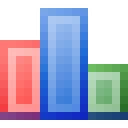

# ACME Data Dash

The ACME Inc. dashboard as a desktop program: a native window (Edge WebView2) running a Rust →
WebAssembly page. Charts are hand-built SVG. ACME Inc. and everyone in it is fictional.

Two tabs:

- **Business:** revenue (hero figure, by month, by category, top products), buyers, top customers, and
  tickets by status.
  - **Shared database:** the window opens the ACME database **read-only, by path** (`--db PATH`,
    `ACME_DB`, the file chosen with **Database…**, or `%LOCALAPPDATA%\ACME Inc\acme.db`) and reads every
    row of `orders`, `products`, `customers` and `tickets`, paged with `?limit=500&offset=N`, through the
    window's own `acme://` protocol (no network port). Writes are refused (405).
  - **Mock snapshot:** with no database (or `--mock`, or *Data → Mock snapshot*) the bundled `mock/`
    snapshot (3,000 orders, 400 tickets).
- **Numbers & tracks:** the two fixture files in `data/`, charted as `data/README.md` describes, with a
  filterable, paged table view.

## Build and run

Needs Rust (MSVC toolchain) with the `wasm32-unknown-unknown` target and `wasm-pack`.

```bash
wasm-pack build --target web --out-dir www/pkg --no-typescript
```

```bash
cargo build --release --features desktop
```

```bash
target\release\acme-dash.exe
```

The exe serves the page from the `www` folder beside it (or this project's `www`). `build.rs` links
`icon/app.res`: the pixel icon and a DPI-aware manifest. The page still runs in a plain browser on the
mock snapshot (`python -m http.server 8711 --directory www`; `?tab=fixtures` opens the second tab).

## Install

```bash
target\release\acme-dash.exe --install
```

Installs for the current user: copies the exe and `www` to `%LOCALAPPDATA%\Programs\ACME Inc\ACME Data Dash\`,
adds **ACME Inc → ACME Data Dash** to the Start menu (`--desktop-shortcut` for the desktop too) and lists it
in **Apps & features**. `--uninstall` (or Apps & features) removes it; the database is never deleted
(`--purge` also removes the program's settings and WebView2 profile). `--root DIR` does all of it inside
DIR. Other flags: `--version`, `--quiet`, `--smoke FILE`.

## Tests

```bash
cargo test
```

```bash
cargo test --features desktop
```

Parsing, aggregation (money summed in whole cents), formatting, chart geometry and the HTML views live
in `src/core` and run on the host. The fixture tests check the counts stated in `data/README.md`. The
second command adds the desktop program's tests (API over an in-memory database built from
`mock/schema.sql`, file serving, installer, settings).

## Charts

Colors are the validated reference palette's first three categorical slots (light and dark steps in
`www/style.css`); single-series charts use slot 1. Bars are ≤ 24px with a rounded data end, lines are
2px, markers carry a surface ring, every mark has a hover tooltip, multi-series charts have a legend,
and the numbers also appear as text (tiles, tables, value labels).

## Dependencies

| Crate | Why |
|---|---|
| `serde`, `serde_json` | Rows and the mock snapshot |
| `wasm-bindgen`, `wasm-bindgen-futures`, `js-sys`, `web-sys` | The standard Rust ↔ browser bindings |
| `tao`, `wry` (feature `desktop`) | The native window and its WebView2, with a custom protocol for the page and API |
| `rusqlite` with `bundled` (feature `desktop`) | The shared SQLite file, read-only; bundled so no SQLite install is needed |

No chart or UI library.

## Icon and license

Icon: Silk "chart_bar" by Mark James, CC BY 2.5, enlarged by nearest-neighbour (`icon/README.md`).
Code: AGPL-3.0, as the rest of the portfolio. `data/numbers.dat` is Wikidata content, CC0 1.0.
